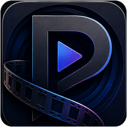

# Parallax Studio v1.0-dev.5.5.3.1

A premium-direction foundation test for the cinematic player in the **Typezer∅ Studio Suite**. The original PowerShell/WinForms Parallax remains a separate stable application and is not replaced by this project.

## This test build

This test adds the DVD playback foundation on top of the validated Blu-ray path. DVDs can play their longest title directly, expose numbered titles for episode and bonus-feature selection, reuse audio/subtitle/chapter navigation, and share the responsive serialized discovery and automatic disc-swap architecture.

The build combines the existing native libmpv foundation with the Studio Suite visual system established by Cadence Studio. It includes live selection of all six approved themes and the three typography profiles, the official Parallax icon, a redesigned cinematic shell, file-open/playback controls, fullscreen routing, optical-drive discovery, independent settings, logging, and resume-store foundations.

See `TESTING.md` for the after-work test sequence and current limitations.

## Build

Place the 64-bit libmpv runtime in `native\`, then run:

```powershell
.\build.ps1 -Run
```

## Stable project boundary

Parallax Studio is a sibling project under `Windows/Apps/Typezer∅ Studio/Parallax Studio/`. It does not overwrite or share runtime state with the PowerShell/WinForms Parallax.

<p align="center">
  
</p>

<h1 align="center">Parallax Studio</h1>

<p align="center">
  A modern Windows desktop fork of Parallax built with C#, WPF, XAML, MVVM, and libmpv.<br>
  The original PowerShell/WinForms Parallax remains an independent, stable project.
</p>

<p align="center">
  
  
  
  
  
</p>

## Project status

**Current build: v1.0-dev.2.2 — Foundation hotfix**

This first build establishes the independent solution, dependency boundaries,
custom WPF player shell, MVVM layer, theme resources, native video host, local
settings, resume-store foundation, optical-disc discovery, logging, and a direct
libmpv adapter.

When `libmpv-2.dll` is present, dev.1 can initialize libmpv inside the native WPF
video surface and provides foundation file playback, pause, stop, relative seek,
and volume control. Position polling, track discovery, resume wiring, disc title
navigation, and control auto-hide are intentionally staged for later builds.

## Important project boundary

Parallax Studio does **not** replace, modify, import, or write configuration into
the original Parallax project. The PowerShell/WinForms application remains stable
on its own version line. Parallax Studio has its own:

- solution and source tree;
- versioning, beginning at `v1.0-dev.2.2`;
- settings under `%LOCALAPPDATA%\ParallaxStudio`;
- logs under `%LOCALAPPDATA%\ParallaxStudio\logs`;
- resume database and libmpv integration.

The original Parallax is the behavioral reference. Features are ported in focused
vertical slices instead of sharing runtime code between the two applications.

## Foundation features

- Three-project solution with one-way dependency flow
- WPF application shell with custom dark title bar and native child-window video surface
- Lightweight MVVM primitives and command handling
- Centralized XAML colors, typography, cards, buttons, sliders, and status treatments
- Direct dynamically loaded libmpv client API adapter with no wrapper-package dependency
- Foundation file playback: open, play/pause, stop, ±5-second seek, and volume
- Independent JSON settings with atomic writes and corrupt-file recovery
- Independent JSON resume store ready for per-file watch-later wiring
- Optical-drive discovery with DVD / Blu-ray / data-disc classification
- Fullscreen shell toggle and keyboard command foundation
- Startup, shutdown, native-backend, and exception logging
- Original Parallax icon carried into the Studio application and README
- PowerShell and CMD build launchers

## Requirements

- Windows 10 or Windows 11, x64
- .NET 10 SDK
- Visual Studio 2026 with the **.NET desktop development** workload, or the `dotnet` CLI
- 64-bit `libmpv-2.dll` for playback

## libmpv setup

Create or use the included `native` folder and place the 64-bit development runtime DLL there:

```text
ParallaxStudio\native\libmpv-2.dll
```

The project copies DLLs from `native` into the app output directory during build.
The shell still launches without libmpv and reports the missing backend without
crashing.

Optional encrypted-disc support can later use `libdvdcss.dll`, `libaacs.dll`, and
its normal configuration. Those files are not included.

## Build and run

```powershell
# From the ParallaxStudio folder
.\build.ps1 -Run
```

Or:

```powershell
dotnet restore .\ParallaxStudio.sln
dotnet build .\ParallaxStudio.sln -c Debug
dotnet run --project .\src\ParallaxStudio.App\ParallaxStudio.App.csproj
```

## Solution layout

```text
ParallaxStudio/
├── native/                              Local native DLL drop folder
├── src/
│   ├── ParallaxStudio.App/              WPF views, XAML resources, MVVM, native HWND host
│   ├── ParallaxStudio.Core/             Playback/disc/track/resume models and contracts
│   └── ParallaxStudio.Infrastructure/   libmpv, JSON stores, disc discovery, logging
├── ARCHITECTURE.md
├── ROADMAP.md
├── CHANGELOG.md
├── Directory.Build.props
├── global.json
└── ParallaxStudio.sln
```

## First test

1. Copy `libmpv-2.dll` into `native`.
2. Run `.\build.ps1 -Run`.
3. Confirm the custom title bar, native video surface, right-side playback panel, and bottom transport dock render correctly.
4. Confirm the backend badge changes from **Checking libmpv** to a client API version.
5. Open a local video and test pause, stop, ±5-second seek, volume, `Space`, arrow keys, `F`, and `Esc`.
6. Click **Disc scan** and confirm ready optical drives appear without blocking the UI.
7. Close and reopen the app; volume and window geometry should restore.
8. Check `%LOCALAPPDATA%\ParallaxStudio\logs\parallax-studio.log`.

See [ARCHITECTURE.md](ARCHITECTURE.md) for design boundaries and
[ROADMAP.md](ROADMAP.md) for the staged parity plan.


## v1.0-dev.4 test focus

This build introduces live audio-track switching, embedded and external subtitles, subtitle delay, and chapter navigation through the new Tracks panel.

## Native dependency bootstrap

Parallax Studio pins its required libmpv package in `native-dependencies.json`. Normal builds remain offline and never download files unexpectedly.

```powershell
.\scripts\Get-NativeDependencies.ps1
.\build.ps1 -Run
```

A one-command explicit bootstrap is also available:

```powershell
.\build.ps1 -Bootstrap -Run
```

The first successful bootstrap writes `native-dependencies.lock.json` containing the resolved archive and DLL SHA-256 values. Future verification uses that lock file. Optional disc libraries remain user-supplied.


## Optical-disc foundation

Blu-rays use libmpv/libbluray direct playback (`bd://longest`) with MakeMKV LibMMBD when available. DVDs use libmpv direct playback (`dvd://`) with pinned libdvdcss 1.5.0 for CSS-protected media. Every DVD source is first opened in an isolated helper process so a native DVD backend failure cannot terminate the Parallax Studio UI. Interactive DVD menus remain deferred.


## Native disc libraries

A fresh bootstrap now attempts to install the complete x64 native playback set into `native/`:

- `libmpv-2.dll` — required playback backend
- `libaacs.dll` — optional AACS support
- `libbdplus.dll` — optional BD+ support
- `libdvdcss-2.dll` — optional CSS-encrypted DVD support

Run:

```powershell
.\build.ps1 -Bootstrap -InstallBootstrapTools -Run
```

Optional libraries never make the normal build fail. The bootstrap records downloaded file hashes in `native-dependencies.lock.json`. No decryption keys are included or downloaded.


### DVD process isolation

DVD playback runs in a dedicated child process and communicates with the Parallax Studio UI over a private named pipe. This keeps native DVD backend failures from terminating the main application.
